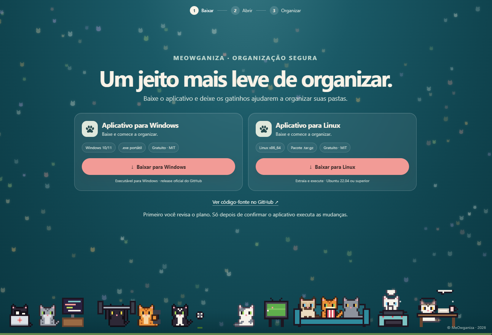
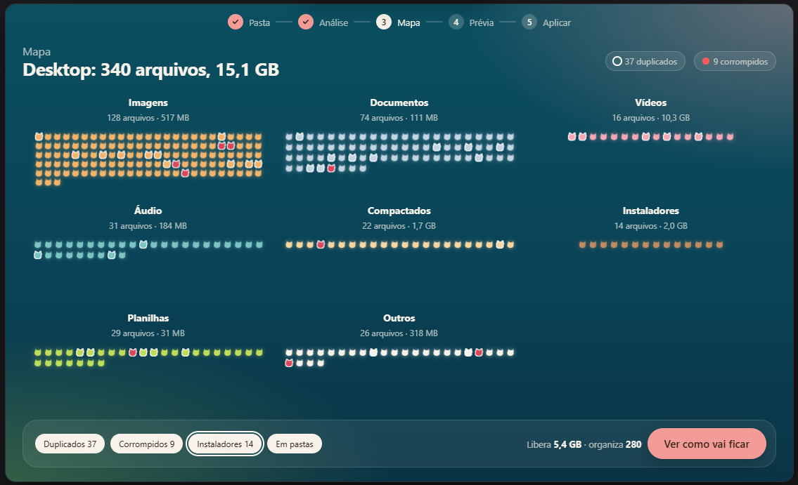
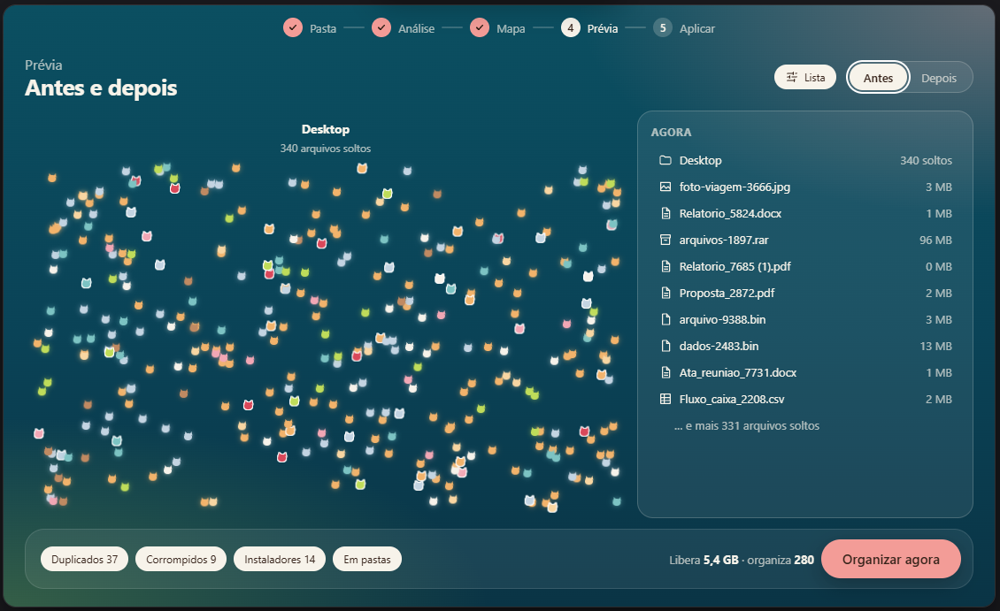
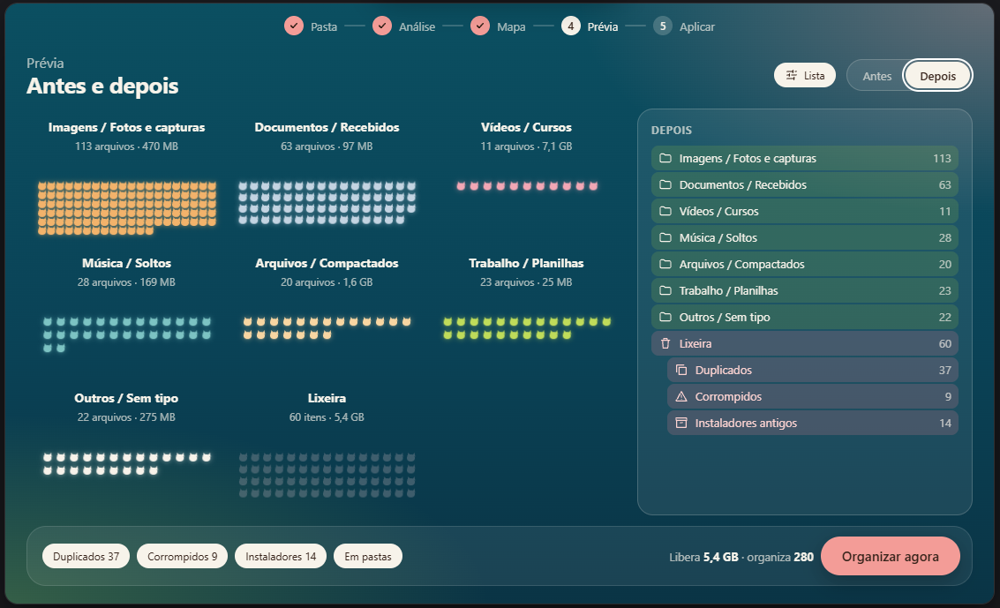
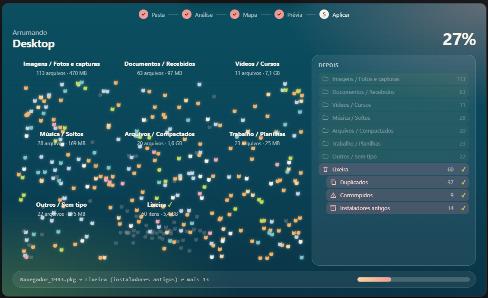
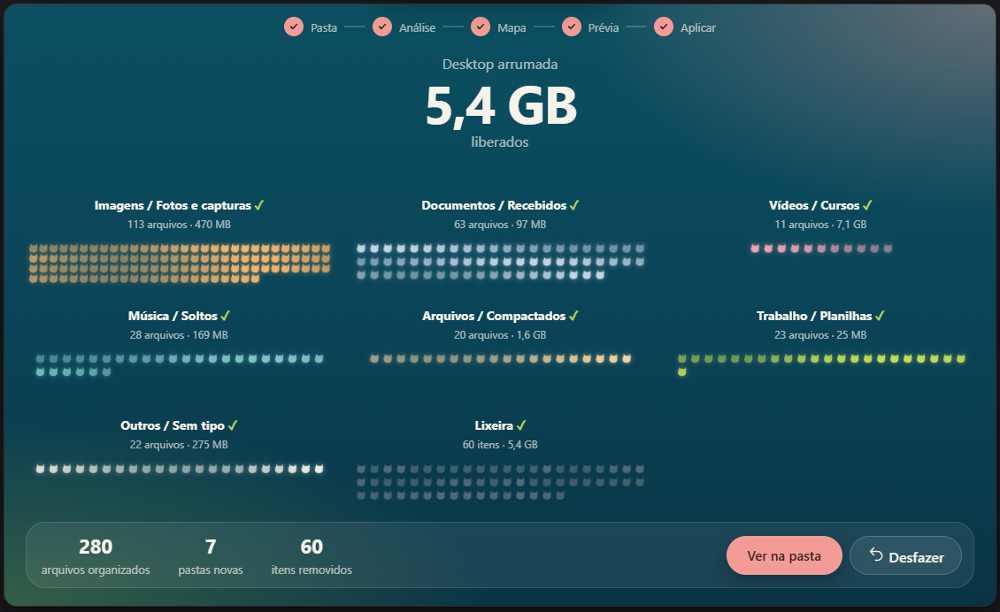

# 🐱 MeOwganiza 2.0

> **Organizador seguro de arquivos** — projeto integrador da disciplina de **Sistemas Operacionais**.

O MeOwganiza organiza pastas por categoria, renomeia arquivos em massa, arquiva itens antigos e gera relatórios. A interface principal é um aplicativo nativo para Windows e Linux.

[](https://github.com/julianasaunders/MeOwganiza/actions/workflows/ci.yml)
[](https://www.python.org/)
[](LICENSE)

**🌐 Demonstração:** [julianasaunders.github.io/MeOwganiza](https://julianasaunders.github.io/MeOwganiza/)

**📥 Download:** [julianasaunders.github.io/MeOwganiza/download.html](https://julianasaunders.github.io/MeOwganiza/download.html)

| 🏷️ Item | 📋 Detalhe |
| --- | --- |
| **Tipo** | Aplicativo local para organização de arquivos |
| **Interfaces** | Aplicativo nativo para Windows, Linux e interface web local |
| **Tecnologias** | Python, HTML, CSS e JavaScript |
| **Requisito** | Python 3.10+ para executar pelo código-fonte |
| **Segurança** | Simula primeiro; só aplica operações mediante confirmação |
| **Licença** | MIT |

---

## 🗺️ Índice

1. [Objetivo](#objetivo)
2. [Problema](#problema)
3. [Escopo e funcionalidades](#escopo-e-funcionalidades)
4. [Requisitos](#requisitos)
5. [Tecnologias](#tecnologias)
6. [Arquitetura](#arquitetura)
7. [Conceitos de Sistemas Operacionais](#conceitos-de-sistemas-operacionais)
8. [Instalação e execução](#instalação-e-execução)
9. [Automação e agendamento](#automação-e-agendamento)
10. [Configuração](#configuração)
11. [Dados e privacidade](#dados-e-privacidade)
12. [Testes](#testes)
13. [Demonstração e deploy](#demonstração-e-deploy)
14. [Estrutura do projeto](#estrutura-do-projeto)
15. [Documentação e contribuição](#documentação-e-contribuição)
16. [Glossário](#glossário)
17. [Equipe e licença](#equipe-e-licença)

---

## Objetivo

Ajudar a organizar arquivos de forma clara e reversível e, ao mesmo tempo, demonstrar conceitos de Sistemas Operacionais aplicados a uma tarefa cotidiana.

## Problema

Pastas com muitos arquivos podem ser difíceis de navegar e organizar manualmente. Automatizar essa tarefa sem uma prévia também pode causar movimentações inesperadas ou perda de dados.

O MeOwganiza separa **planejamento** e **execução**: primeiro mostra o que pretende fazer; a pessoa revisa e confirma antes de qualquer alteração.

## Escopo e funcionalidades

| ✨ Recurso | 📋 O que faz |
| --- | --- |
| **Organização por categoria** | Agrupa arquivos por extensão, usando categorias configuráveis |
| **Simulação e prévia** | Planeja as operações sem alterar arquivos |
| **Filtros** | Filtra por padrão, idade, tamanho, categoria, subdiretórios e arquivos ocultos |
| **Renomeação em massa** | Usa padrões com `{name}`, `{ext}`, `{seq}` e `{date}` |
| **Arquivamento** | Move arquivos antigos para `Arquivo/AAAA/` quando solicitado |
| **Relatórios** | Gera relatórios em Markdown, CSV ou JSON |
| **Desfazer** | Usa o journal para restaurar uma execução anterior, quando possível |
| **Diagnóstico** | Exibe informações de CPU, memória, disco, processo e permissões |
| **Automação** | Inclui scripts e opções de agendamento para Linux/macOS e Windows |
| **Interface gráfica** | Aplicativo nativo no Windows e interface web local |
| **Tema** | Modo claro e escuro na interface gráfica |

### Segurança em primeiro lugar

- `organize` apenas simula por padrão; use `--apply` para executar.
- Operações reais pedem confirmação, exceto quando `--yes` é informado.
- Arquivos não são sobrescritos nem excluídos; colisões recebem um nome único.
- As operações são registradas em journal e podem ser desfeitas conforme o estado dos arquivos.
- O aplicativo funciona localmente e não envia os arquivos para um servidor.

> A demonstração online é ilustrativa. Para organizar arquivos do computador, use o aplicativo ou a CLI local.

## Requisitos

### Requisitos funcionais

| Código | Requisito |
| --- | --- |
| **RF01** | Analisar uma pasta e planejar a organização dos arquivos |
| **RF02** | Permitir filtros, categorias e regras de renomeação configuráveis |
| **RF03** | Exibir uma prévia antes de executar operações |
| **RF04** | Aplicar operações somente mediante solicitação explícita |
| **RF05** | Registrar operações, gerar relatórios e permitir desfazer uma execução |
| **RF06** | Diagnosticar recursos e permissões relevantes do sistema |

### Requisitos não funcionais

| Código | Requisito |
| --- | --- |
| **RNF01** | Segurança por padrão: simular antes de aplicar |
| **RNF02** | Não sobrescrever nem excluir arquivos |
| **RNF03** | Executar a CLI em Windows, Linux e macOS com Python 3.10+ |
| **RNF04** | Não exigir dependências externas para a CLI; `pywebview` é opcional para a janela nativa |
| **RNF05** | Manter registros locais para apoiar a reversibilidade |

## Tecnologias

| 🔧 Tecnologia | 📝 Uso |
| --- | --- |
| **Python 3.10+** | CLI, planejamento, execução, relatórios e diagnóstico |
| **HTML, CSS e JavaScript** | Interface web e conteúdo da interface gráfica |
| **pywebview** | Dependência opcional da janela nativa do Windows |
| **`unittest`** | Testes automatizados |
| **GitHub Actions / GitHub Pages** | Integração contínua e demonstração do projeto |

## Arquitetura

O fluxo principal mantém o planejamento separado das alterações no disco:

```text
Selecionar uma pasta
       │
       ▼
Analisar arquivos ──► Planejar destinos e operações
                              │
                              ▼
                        Revisar a prévia
                              │
                       confirmação + --apply
                              │
                              ▼
Executar operações ──► Journal ──► Relatórios / desfazer
```

| Módulo | Responsabilidade |
| --- | --- |
| `planner.py` | Analisa arquivos e monta o plano sem executar mudanças |
| `executor.py` | Executa o plano confirmado e registra as operações |
| `journal.py` | Persiste o histórico necessário para consultar e desfazer execuções |
| `reporter.py` | Gera relatórios Markdown, CSV e JSON |
| `system_info.py` | Coleta informações do sistema operacional |
| `web.py` / `native.py` | Disponibiliza as interfaces web local e nativa |

## Conceitos de Sistemas Operacionais

O projeto demonstra conceitos da disciplina por meio de operações reais em um diretório de teste:

| Conceito | Onde aparece | Como observar |
| --- | --- | --- |
| **Sistema de arquivos** | `planner.py`, `executor.py` | Prévia de origem e destino |
| **Chamadas de sistema** | `journal.py`, `reporter.py` | Journal e relatórios gerados |
| **Processos e CPU** | `system_info.py` | PID, PPID, threads e núcleos |
| **Memória e disco** | `system_info.py`, `planner.py` | Recursos disponíveis e espaço livre |
| **Permissões** | `system_info.py`, `planner.py` | Permissões do diretório-alvo |
| **Concorrência** | `utils.py`, `executor.py` | Resolução de colisões com nomes únicos |
| **Automação** | `scripts/` | Cron e Agendador de Tarefas |
| **Tolerância a falhas** | `journal.py`, `undo` | Recuperação de operações registradas |

## Instalação e execução

### Para quem vai usar o aplicativo

Acesse a **[página de downloads do MeOwganiza](https://julianasaunders.github.io/MeOwganiza/download.html)** e escolha o pacote do seu sistema:

| Sistema | Arquivo | Como abrir |
| --- | --- | --- |
| **Windows 10/11** | `MeOwganiza.exe` | Baixe e abra o executável. Não precisa instalar Python. |
| **Linux x86_64** | `MeOwganiza-linux-x86_64.tar.gz` | Extraia, torne o arquivo executável com `chmod +x MeOwganiza` e execute `./MeOwganiza`. |



O pacote Linux é gerado em Ubuntu 22.04 para x86_64 e está incluído no arquivo `.tar.gz`.

### Requisitos para executar pelo código-fonte

- Python **3.10 ou superior**.
- Windows, Linux ou macOS para a CLI.
- Windows para o executável nativo `.exe`.
- Linux x86_64 para o executável desktop Linux.

### Preparar o ambiente

```bash
git clone https://github.com/julianasaunders/MeOwganiza.git
cd MeOwganiza
python -m venv .venv
python -m pip install --upgrade pip
python -m pip install -e .
```

No Windows, ative o ambiente com `.\.venv\Scripts\Activate.ps1`; no Linux/macOS, use `source .venv/bin/activate`.

### Comandos úteis

```bash
# Criar uma pasta de demonstração
python meowganiza.py demo sandbox_teste

# Simular a organização (não altera arquivos)
python meowganiza.py organize sandbox_teste

# Aplicar depois de revisar e confirmar o plano
python meowganiza.py organize sandbox_teste --apply

# Desfazer a execução mais recente
python meowganiza.py undo --latest

# Ver diagnóstico do sistema
python meowganiza.py doctor

# Abrir o menu guiado
python meowganiza.py interactive

# Abrir a interface web local
python meowganiza.py web
```

> Antes de usar `--apply` em uma pasta real, revise o plano e mantenha backups dos dados importantes.

### Interface nativa

Para executar a interface desktop pelo código-fonte, instale o backend de interface do seu sistema:

```powershell
# Windows
python -m pip install -e ".[native]"
python meowganiza.py native
```

```bash
# Linux (backend Qt/WebEngine)
python -m pip install -e ".[native-linux]"
python meowganiza.py native
```

## Automação e agendamento

Há scripts para executar tarefas e agendá-las nos sistemas suportados. Revise o alvo e teste primeiro sem `--apply`.

### Linux/macOS

```bash
./scripts/automacao.sh --target ~/Downloads --apply --report
./scripts/agendar_cron.sh --target ~/Downloads --time 09:00 --apply
```

### Windows (PowerShell)

```powershell
.\scripts\automacao.ps1 -Target "$HOME\Downloads" -Apply -Report
.\scripts\agendar_tarefa.ps1 -Target "$HOME\Downloads" -Time "09:00" -Register
```

## Configuração

A configuração é procurada nesta ordem: `--config CAMINHO`, `MEOWGANIZA_CONFIG`, `<MEOWGANIZA_HOME>/config.json` e `config/meowganiza.example.json`.

| Variável | Finalidade |
| --- | --- |
| `MEOWGANIZA_HOME` | Define o diretório de estado, logs e journal |
| `MEOWGANIZA_CONFIG` | Define o arquivo JSON de configuração |
| `MEOWGANIZA_TARGET` | Define a pasta-alvo padrão |

O diretório de estado segue o padrão XDG em Linux/macOS e `%LOCALAPPDATA%` no Windows. `MEOWGANIZA_HOME` permite defini-lo manualmente.

Exemplo completo: [`config/meowganiza.example.json`](config/meowganiza.example.json).

## Dados e privacidade

O processamento é local: os arquivos analisados permanecem no computador. O estado, o journal e os relatórios são gravados localmente. A demonstração hospedada no GitHub Pages apresenta o projeto e não acessa pastas do seu computador.

A aplicação não faz chamadas de rede. Consulte [`SECURITY.md`](SECURITY.md) para garantias, limitações conhecidas e boas práticas.

## Testes

Execute a suíte completa na raiz do repositório:

```bash
python -m unittest discover -s tests -v
```

Os testes cobrem configuração, CLI, planejamento, execução, journal, desfazer, relatórios, diagnóstico e fluxos integrados.

## Demonstração e deploy

A página pública do projeto está em [julianasaunders.github.io/MeOwganiza](https://julianasaunders.github.io/MeOwganiza/). Ela apresenta o projeto e sua demonstração visual.

### Demonstração visual

**1. Escolha a pasta** que será organizada.


**2. Mapa dos arquivos analisados.**



**3–4. Revise a prévia antes e depois da organização.**





**5. Acompanhe a organização em andamento.**



**6. Confira o resultado.**



A interface web local também pode ser aberta com `python meowganiza.py web`; ela é servida no próprio computador, por padrão em `127.0.0.1:8765`.

## Estrutura do projeto

```text
MeOwganiza/
├── src/meowganiza/   # CLI, planejamento, execução, journal e relatórios
├── ui/               # interfaces web e galeria de layouts
├── tests/            # testes automatizados
├── scripts/          # automação, agendamento e hooks
├── config/           # configuração de exemplo
├── docs/             # documentação do projeto
├── index.html        # página de apresentação (GitHub Pages)
├── meowganiza.py     # atalho para executar pelo código-fonte
├── pyproject.toml    # metadados e comandos instaláveis
├── LICENSE
└── README.md
```

## Documentação e contribuição

| 📄 Documento | 📋 Conteúdo |
| --- | --- |
| [`docs/PLANEJAMENTO.md`](docs/PLANEJAMENTO.md) | Escopo, backlog e divisão de tarefas |
| [`docs/ARQUITETURA.md`](docs/ARQUITETURA.md) | Módulos e fluxo de dados |
| [`docs/CONCEITOS-SO.md`](docs/CONCEITOS-SO.md) | Conceitos de Sistemas Operacionais aplicados |
| [`docs/GUIA-DE-USO.md`](docs/GUIA-DE-USO.md) | Guia de uso completo |
| [`docs/TESTES.md`](docs/TESTES.md) | Estratégia e execução dos testes |
| [`docs/RELEASE.md`](docs/RELEASE.md) | Checklist de release |
| [`CONTRIBUTING.md`](CONTRIBUTING.md) | Como contribuir |
| [`CODE_OF_CONDUCT.md`](CODE_OF_CONDUCT.md) | Código de conduta |
| [`SECURITY.md`](SECURITY.md) | Política de segurança |
| [Wiki do projeto](https://github.com/julianasaunders/MeOwganiza/wiki) | Instalação, arquitetura e perguntas frequentes |

## Glossário

| Termo | Significado |
| --- | --- |
| **Simulação** | Plano exibido sem alterar arquivos |
| **Journal** | Registro local das operações de uma execução |
| **Undo** | Tentativa segura de restaurar uma execução registrada |
| **CLI** | Interface de linha de comando |

## Equipe e licença

- **Juliana Saunders** — [@julianasaunders](https://github.com/julianasaunders)
- **Jaquelline Feitoza** — [@jaquellinef](https://github.com/jaquellinef)

Distribuído sob a licença **MIT**. Consulte [`LICENSE`](LICENSE).
