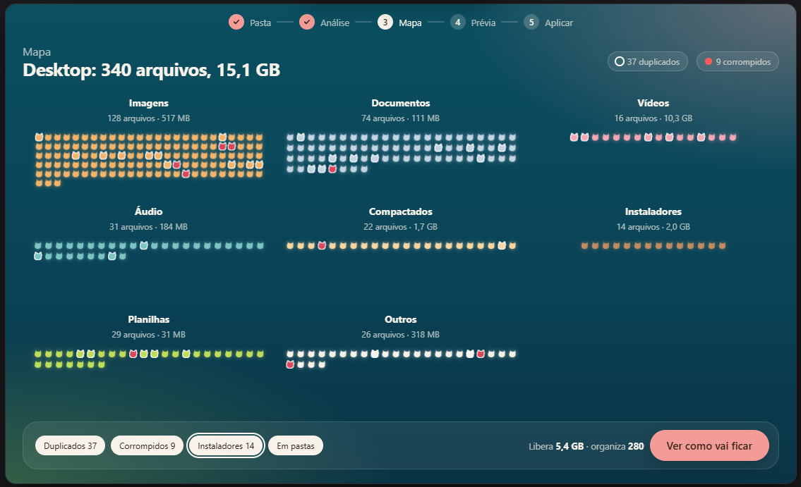
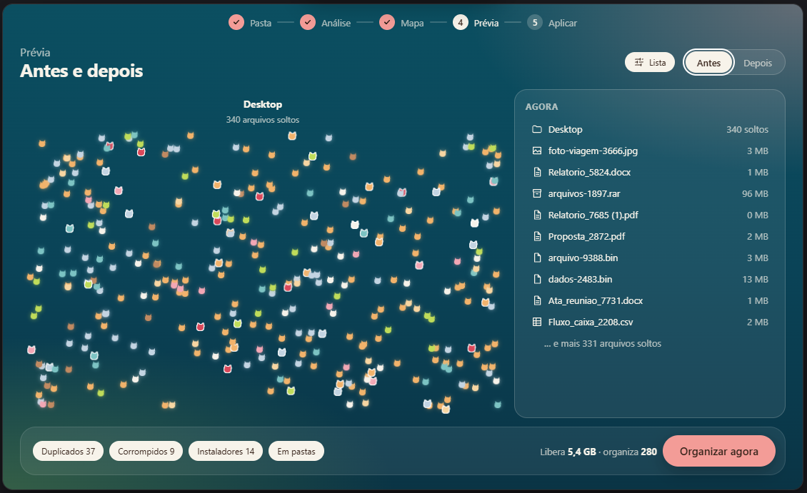
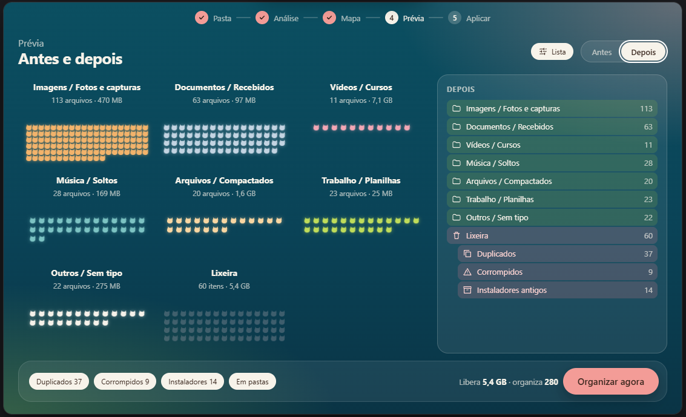
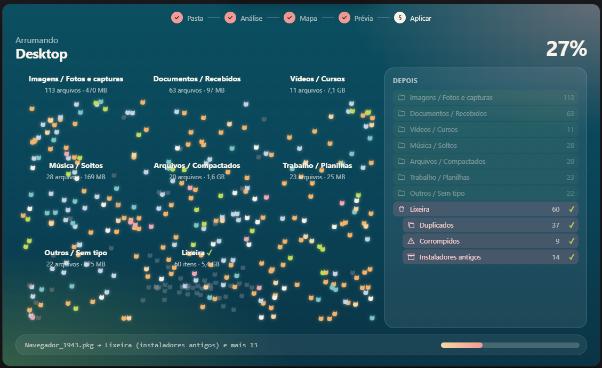
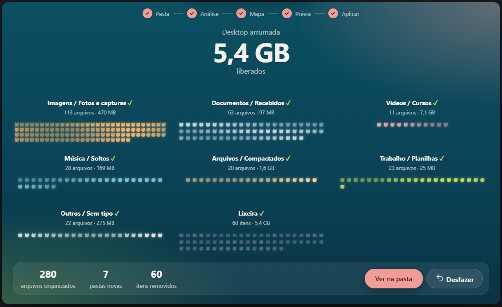

# Demonstração e deploy

[← Voltar ao README principal](../README.md)

## Visão geral

## Demonstração

[Vídeo completo da demonstração (MP4)](https://raw.githubusercontent.com/julianasaunders/MeOwganiza/main/docs/images/demo.mp4)

## Passo a passo em imagens

**1. Escolha a pasta** que será organizada.

**2. Mapa dos arquivos analisados.**

**3–4. Revise a prévia antes e depois da organização.**

**5. Acompanhe a organização em andamento.**

**6. Confira o resultado.**

## Interface web local

A interface web local pode ser aberta com `python meowganiza.py web`; ela é servida no próprio computador, por padrão em `127.0.0.1:8765`.

## Próximos passos

- [Download e instalação](INSTALACAO.md) — para organizar arquivos reais
- [Guia de uso no terminal](GUIA-DE-USO.md) — reproduza os passos da demonstração no seu computador
