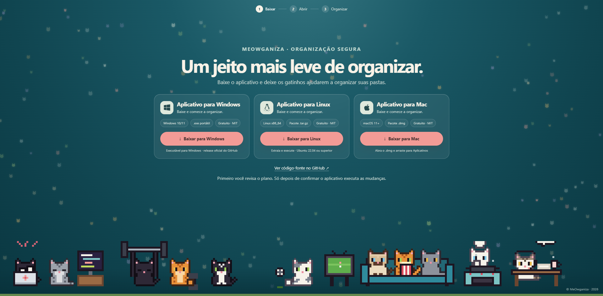

# Instalação e execução

[← Voltar ao README principal](../README.md)

## Para quem vai usar o aplicativo

Acesse a **[página de downloads do MeOwganiza](https://julianasaunders.github.io/MeOwganiza/download.html)** e escolha o pacote do seu sistema:

| Sistema | Arquivo | Como abrir |
| --- | --- | --- |
| **Windows 10/11** | `MeOwganiza.exe` | Baixe e abra o executável. Não precisa instalar Python. |
| **Linux x86_64** | `MeOwganiza-linux-x86_64.tar.gz` | Extraia, torne o arquivo executável com `chmod +x MeOwganiza` e execute `./MeOwganiza`. |
| **macOS 11+** | `MeOwganiza-macos-arm64.dmg` | Abra o `.dmg` e arraste o aplicativo para a pasta Aplicativos. |



O pacote Linux é gerado em Ubuntu 22.04 para x86_64 e está incluído no arquivo `.tar.gz`. O pacote macOS é distribuído em um arquivo `.dmg`.

## Requisitos para executar pelo código-fonte

- Python **3.10 ou superior**.
- Windows, Linux ou macOS para a CLI.
- Windows para o executável nativo `.exe`.
- Linux x86_64 para o executável desktop Linux.
- macOS 11+ para o aplicativo desktop `.dmg`.

## Preparar o ambiente

```bash
git clone https://github.com/julianasaunders/MeOwganiza.git
cd MeOwganiza
python -m venv .venv
python -m pip install --upgrade pip
python -m pip install -e .
```

No Windows, ative o ambiente com `.\.venv\Scripts\Activate.ps1`; no Linux/macOS, use `source .venv/bin/activate`.

## Comandos úteis

```bash
# Criar uma pasta de demonstração
python meowganiza.py demo sandbox_teste

# Simular a organização (não altera arquivos)
python meowganiza.py organize sandbox_teste

# Aplicar depois de revisar e confirmar o plano
python meowganiza.py organize sandbox_teste --apply

# Desfazer a execução mais recente
python meowganiza.py undo --latest

# Ver diagnóstico do sistema
python meowganiza.py doctor

# Abrir o menu guiado
python meowganiza.py interactive

# Abrir a interface web local
python meowganiza.py web
```

> Antes de usar `--apply` em uma pasta real, revise o plano e mantenha backups dos dados importantes.

## Interface nativa

Para executar a interface desktop pelo código-fonte, instale o backend de interface do seu sistema:

```powershell
# Windows
python -m pip install -e ".[native]"
python meowganiza.py native
```

```bash
# Linux (backend Qt/WebEngine)
python -m pip install -e ".[native-linux]"
python meowganiza.py native
```

```bash
# macOS (backend nativo Cocoa/WebKit)
python -m pip install -e ".[native-macos]"
python meowganiza.py native
```

## Automação e agendamento

Há scripts para executar tarefas e agendá-las nos sistemas suportados. Revise o alvo e teste primeiro sem `--apply`.

### Linux/macOS

```bash
./scripts/automacao.sh --target ~/Downloads --apply --report
./scripts/agendar_cron.sh ~/Downloads --install
```

### Windows (PowerShell)

```powershell
.\scripts\automacao.ps1 -Target "$HOME\Downloads" -Apply -Report
.\scripts\agendar_tarefa.ps1 -Target "$HOME\Downloads" -Time "09:00" -Register
```

## Próximos passos

- [Guia de uso](GUIA-DE-USO.md) — cenários completos, filtros e renomeação
- [Configuração e privacidade](CONFIGURACAO.md) — ajustes e variáveis de ambiente
- [Testes](TESTES.md) — como rodar a suíte localmente
